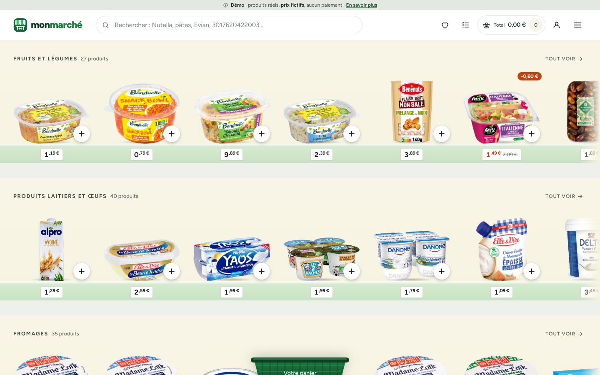
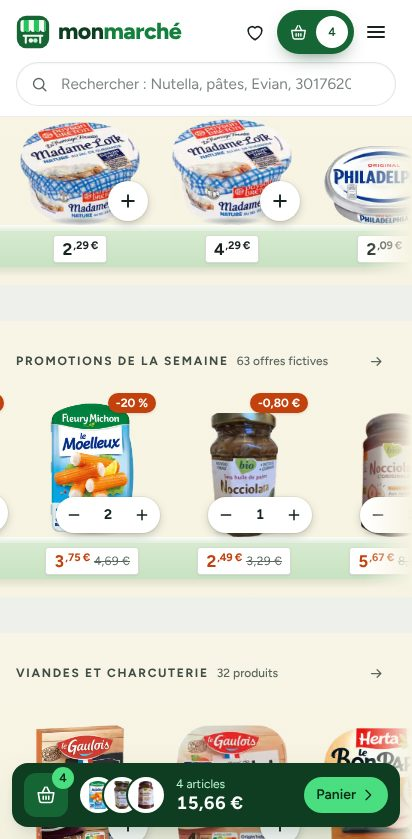
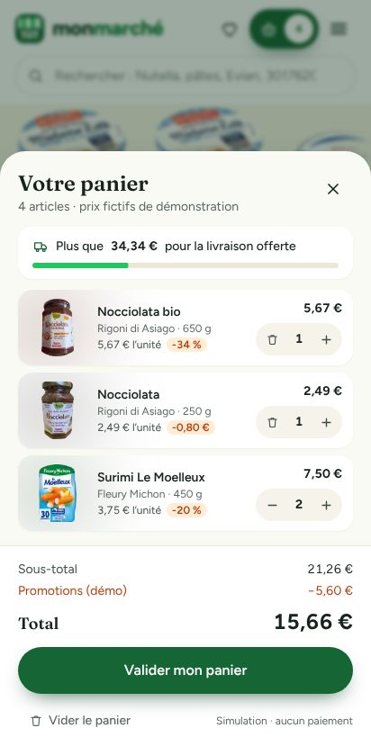

# MON MARCHÉ

**Vos courses, rayon par rayon.** Un supermarché en ligne qu'on parcourt comme un
vrai magasin : des étagères, de vrais produits français avec leur véritable
emballage, et un panier qui se remplit d'un geste.



> ⚠️ **Démonstration.** Les produits sont réels ; **les prix et promotions sont
> fictifs**. Aucune commande n'est transmise, aucun paiement n'est demandé.

## En bref

- 🛒 **588 vrais produits** vendus en France, rangés dans **18 rayons** (fruits et
  légumes, crèmerie, fromages, épicerie, boissons, hygiène, bébé, animaux…).
- 🧺 **Un panier immédiat** : touchez « + », le produit file dans le panier, le total
  se met à jour, et tout est conservé d'une visite à l'autre.
- 🔎 **Une recherche tolérante** (accents, fautes de frappe, codes-barres) qui filtre
  les rayons pendant qu'on tape, avec filtres et tris.
- 📋 Fiches produits complètes, favoris, **listes de courses partageables**,
  produits vus récemment, promotions, commande simulée, administration.
- 📱 Pensé autant pour le téléphone que pour l'ordinateur, accessible au clavier
  et aux lecteurs d'écran.
- 🔓 **Open source** : le code est libre (licence MIT).

 

## Par où commencer ?

| Vous voulez… | Lisez |
| --- | --- |
| **Comprendre le projet de A à Z** (pour tout le monde) | 📘 [Le guide complet](docs/GUIDE.md) |
| Savoir **utiliser le site** | [Faire ses courses : mode d'emploi](docs/GUIDE.md#2-faire-ses-courses--mode-demploi) |
| **L'installer** sur votre ordinateur | [Installation pas à pas](docs/GUIDE.md#7-installer-le-projet-sur-son-ordinateur) |
| **Le mettre en ligne** gratuitement | [Déploiement (Vercel + Neon)](docs/DEPLOIEMENT.md) |
| Savoir **d'où viennent les produits** et les photos | [Le catalogue](docs/CATALOGUE.md) · [Rapport d'import](docs/CATALOGUE-RAPPORT.md) |
| Comprendre **comment c'est construit** | [Architecture](docs/ARCHITECTURE.md) |
| Voir **l'inspiration** et les choix d'interface | [Analyse de la vidéo de référence](docs/ANALYSE-VIDEO.md) |
| **Contribuer** | [Guide de contribution](CONTRIBUTING.md) |
| Connaître **les licences** | [Licences et attributions](docs/LICENCES.md) |

## Démarrage rapide (développeurs)

Prérequis : Node.js 22, pnpm 10, Docker (ou PostgreSQL 16).

```bash
pnpm install
```

```bash
cp .env.example .env
```

```bash
docker compose up -d db
```

```bash
pnpm db:setup
```

```bash
pnpm dev
```

Puis ouvrez http://localhost:3000. Le catalogue est fourni avec le projet : aucune
connexion à une API externe n'est nécessaire.

| Commande | Rôle |
| --- | --- |
| `pnpm dev` · `pnpm build` · `pnpm start` | développement, build de production, serveur |
| `pnpm test` · `pnpm test:e2e` | tests automatiques (logique, base de données, navigateur réel) |
| `pnpm lint` · `pnpm typecheck` | vérifications du code |
| `pnpm db:setup` | crée la base et importe le catalogue |
| `pnpm catalog:import` · `pnpm catalog:refresh` | régénère / met à jour le catalogue depuis Open Food Facts |
| `pnpm admin:create` | crée un compte administrateur |

## Technologies

Next.js 16 · React 19 · TypeScript · Tailwind CSS 4 · PostgreSQL 16 + Drizzle ORM ·
Zod · Zustand · Motion · Vitest · Playwright · Docker.
Les raisons de ces choix : [docs/ARCHITECTURE.md](docs/ARCHITECTURE.md).

## Sources et licences

- **Code** : [MIT](LICENSE).
- **Données produits** : © contributeurs [Open Food Facts](https://fr.openfoodfacts.org)
  et bases sœurs, licence [ODbL 1.0](https://opendatacommons.org/licenses/odbl/1-0/).
- **Photos** : contributeurs Open Food Facts, licence
  [CC BY-SA 3.0](https://creativecommons.org/licenses/by-sa/3.0/deed.fr) (auteurs dans
  `public/catalog/images/ATTRIBUTIONS.md`).
- Les marques citées appartiennent à leurs propriétaires et ne sont pas associées au projet.
