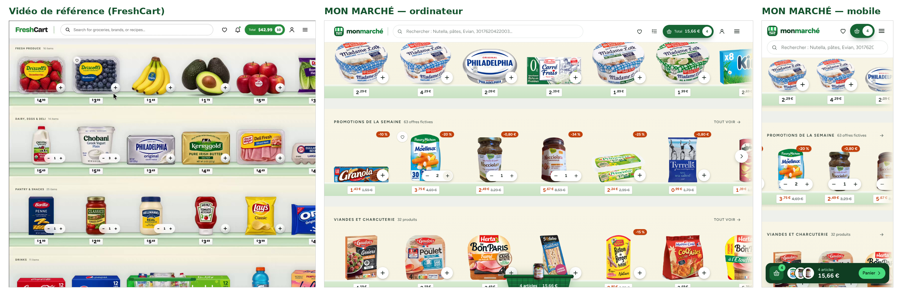

# Analyse de la vidéo de référence (FreshCart) et choix pour MON MARCHÉ

Analyse image par image de la vidéo fournie (2 min 29 s, interface « FreshCart » sur ordinateur).

## Maquette : la vidéo et MON MARCHÉ côte à côte

L'interface reprend la grammaire visuelle de la vidéo : en-tête blanc sur une ligne
(logo, recherche, favoris, pastille « Total », compte, menu), rayons empilés avec un
petit libellé en capitales, fond crème jusqu'à une étagère en verre teinté vert au
chant épais, étiquettes de prix blanches clipsées sur le chant, bouton « + » blanc
devenant « − 1 + », panier posé en bas de l'écran.

## Ce que montre la vidéo

| Thème | Observation |
| --- | --- |
| Organisation des rayons | Une page unique de grandes étagères horizontales empilées : « Fresh produce », « Dairy, eggs & deli », « Pantry & snacks », « Drinks ». Chaque étagère porte un petit libellé en capitales et son nombre d'articles (« 16 items »). Les produits débordent à droite de l'écran : on comprend immédiatement qu'on peut faire défiler. |
| Produits | De vrais emballages **détourés**, posés sur une fine tablette vert pâle façon verre, à taille visuelle cohérente. Pas de carte produit, pas de cadre : l'emballage est l'interface. Le prix est écrit sous la tablette, centimes en exposant. |
| Interactions produit | Un bouton rond « + » en bas à droite de l'emballage. Après un clic, il devient un compteur « − 1 + » posé sur le bas du produit. Un cœur (favori) apparaît au survol en haut à gauche. Le produit se soulève légèrement au survol. |
| Animation d'ajout | Une copie de l'emballage saute vers le haut puis tombe en tournant légèrement dans un **panier physique** posé au centre du bas de l'écran ; le panier se remplit de miniatures. |
| Panier et total | Pastille « Total 12,75 $ (4) » dans l'en-tête, verte dès qu'elle n'est plus vide. Un clic sur le panier ouvre un tiroir latéral « Your cart · 23 items » : miniature, nom et format, prix unitaire, total de ligne, compteur ; barre « livraison offerte débloquée » ; sous-total, livraison, total ; gros bouton « Place order ». À l'ouverture, les lignes arrivent en cascade avec un halo coloré. |
| Défilement | Défilement vertical de la page, horizontal par étagère, sans interférence. |
| Recherche | La saisie filtre les étagères **sur place** : chaque rayon affiche « 2 of 16 », les produits non pertinents disparaissent, les rayons vides aussi. |

## Ce qui rend l'expérience agréable

1. Le produit réel est le héros : aucune carte, aucun texte superflu.
2. La réponse est immédiate (compteur, total) et l'animation n'est que la confirmation.
3. La métaphore physique du panier rend l'action tangible.
4. La recherche conserve la géographie du magasin.

## Ce que MON MARCHÉ reprend, adapte et ajoute

- **Repris** : étagères horizontales empilées, emballages détourés posés sur une tablette, bouton « + » devenant compteur, panier physique en bas d'écran qui se remplit, pastille « Total », tiroir panier avec progression vers la livraison offerte, recherche qui filtre les rayons sur place (« 3 sur 42 »).
- **Notre identité** : marque « mon marché » (store bâché de primeur), typographies Fraunces et Figtree, palette vert profond / vert frais / crème, tablette en verre teinté vert, panier en osier vert dessiné pour le projet, halos de couleur extraits de chaque emballage.
- **Adapté au marché français** : prix en euros au format français (« 2,49 € »), **prix au kilo / au litre** (mention attendue en magasin), Nutri-Score, label bio, 18 rayons à la française (crèmerie, fromages, boucherie, marée…), produits réellement vendus en France, marques de distributeurs exclues pour éviter toute confusion avec des prix d'enseigne.
- **Au-delà de la vidéo** : fiche produit détaillée (ingrédients, allergènes, valeurs nutritionnelles, source), navigation directe par rayon, filtres et tris, favoris, listes de courses partageables, produits vus récemment, promotions de démonstration, parcours de commande simulé, administration, mobile soigné (barre panier flottante, feuilles glissantes), accessibilité (clavier, lecteurs d'écran, mouvement réduit).

## Exigence « emballages détourés »

Comme dans la vidéo, **seuls des emballages proprement détourés sont mis en rayon**. Les photos de la communauté Open Food Facts étant souvent prises en main ou sur une table, le pipeline d'import (voir `docs/CATALOGUE.md`) :

1. privilégie les photos de face sur fond uni (« packshots »), détourées géométriquement sans perte ;
2. confie les autres à un modèle de segmentation (IS-Net, licence Apache 2.0) ;
3. valide chaque masque (silhouette unique, pleine, opaque, fond réellement retiré) et rejette le reste ;
4. fait l'objet d'une revue visuelle par planches de contrôle.
