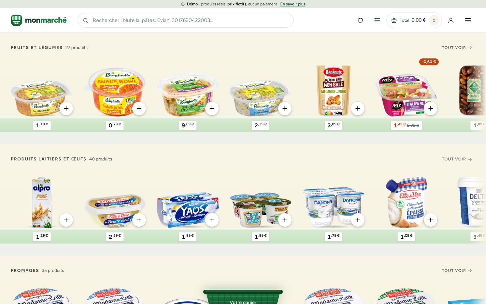
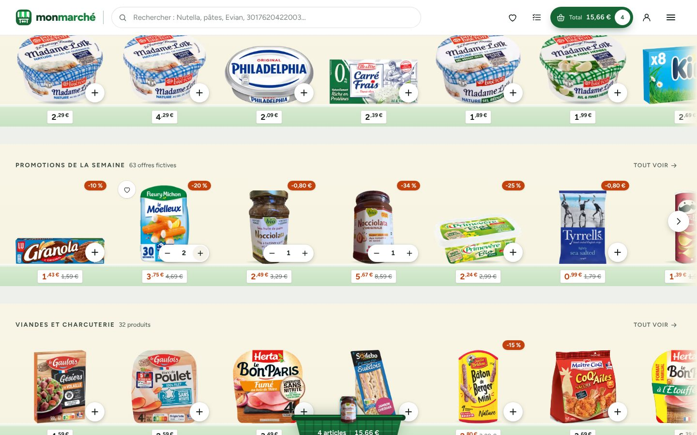
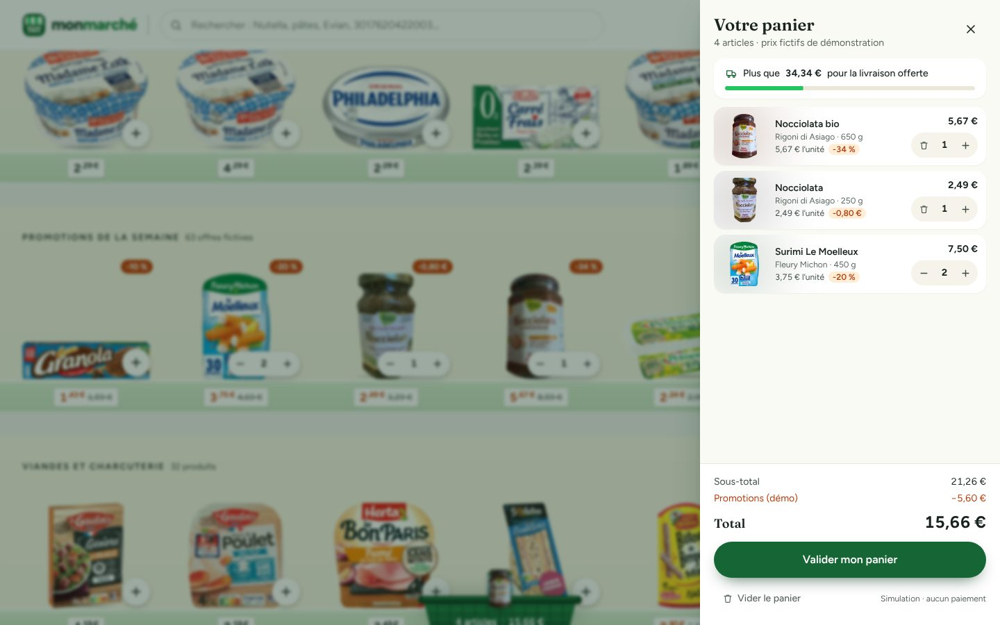
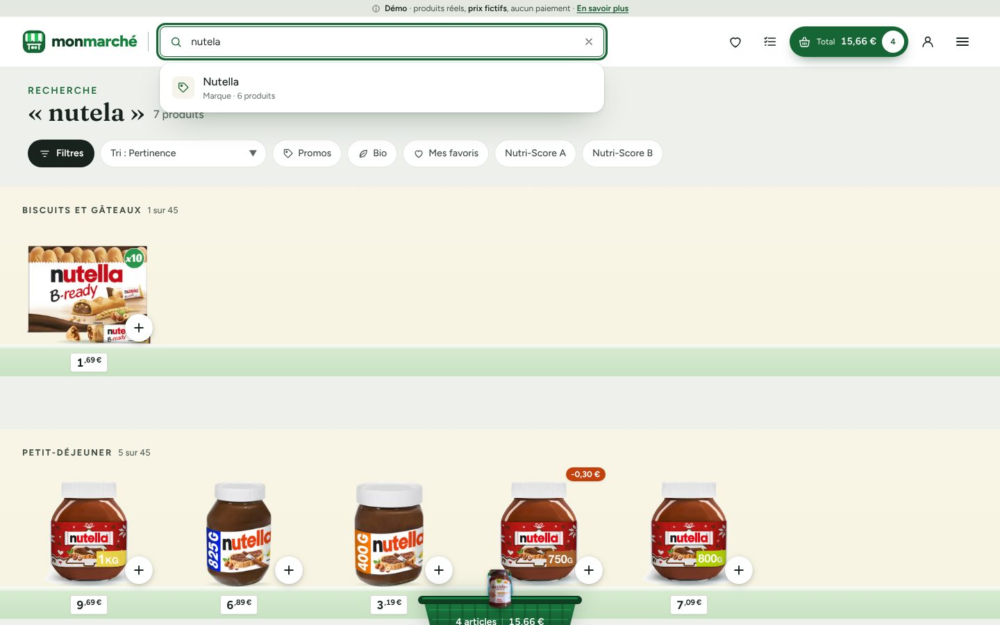
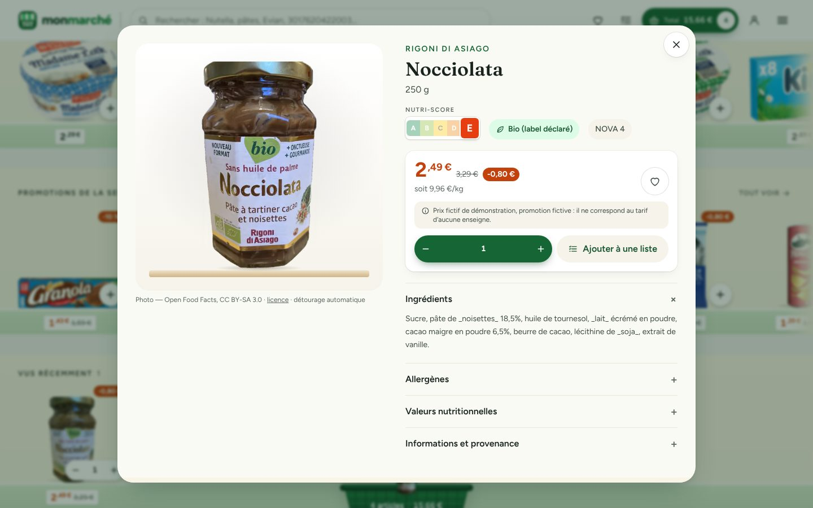
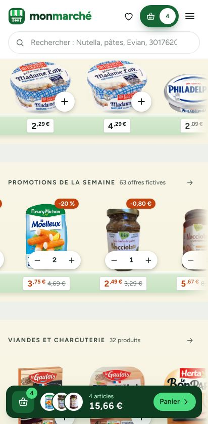
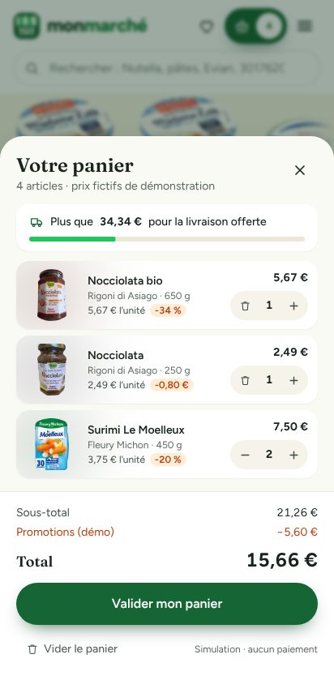

# Le guide complet de MON MARCHÉ, de A à Z

Ce guide s'adresse à **tout le monde** : curieux, clients de démonstration,
étudiants, développeurs débutants ou confirmés. Chaque partie peut se lire seule.
Les mots techniques sont expliqués dans le [lexique](#13-lexique) en fin de page.

**Sommaire**

1. [MON MARCHÉ en deux minutes](#1-mon-marché-en-deux-minutes)
2. [Faire ses courses : mode d'emploi](#2-faire-ses-courses--mode-demploi)
3. [D'où viennent les produits et les photos ?](#3-doù-viennent-les-produits-et-les-photos-)
4. [Les prix : pourquoi sont-ils fictifs ?](#4-les-prix--pourquoi-sont-ils-fictifs-)
5. [Vos données et votre vie privée](#5-vos-données-et-votre-vie-privée)
6. [Comment le site fonctionne (sans jargon)](#6-comment-le-site-fonctionne-sans-jargon)
7. [Installer le projet sur son ordinateur](#7-installer-le-projet-sur-son-ordinateur)
8. [Mettre le site en ligne](#8-mettre-le-site-en-ligne)
9. [L'administration](#9-ladministration)
10. [Mettre à jour le catalogue](#10-mettre-à-jour-le-catalogue)
11. [La carte du code](#11-la-carte-du-code)
12. [Qualité : tests, accessibilité, sécurité](#12-qualité--tests-accessibilité-sécurité)
13. [Lexique](#13-lexique)
14. [Questions fréquentes](#14-questions-fréquentes)
15. [Et ensuite ? Idées pour la suite](#15-et-ensuite--idées-pour-la-suite)

---

## 1. MON MARCHÉ en deux minutes

**MON MARCHÉ est un supermarché en ligne qu'on parcourt comme un vrai magasin.**
Au lieu d'une liste de vignettes, on se promène devant des étagères : chaque rayon
(fruits et légumes, crèmerie, fromages, boissons…) est une étagère sur laquelle
sont posés de vrais produits vendus en France, avec leur véritable emballage.
On touche « + » sous un produit : il saute dans le panier.



- **588 vrais produits**, de 18 rayons, avec leur marque, leur format, leur photo.
- **Un panier immédiat**, conservé d'une visite à l'autre.
- **Une recherche** qui filtre les rayons pendant qu'on tape, même avec une faute.
- **Gratuit et ouvert** : tout le code est public et réutilisable (licence MIT).

> **Important** : c'est une **démonstration**. Les produits sont réels, mais les
> **prix sont inventés** et **aucune commande n'est envoyée**, aucun paiement n'est
> demandé.

---

## 2. Faire ses courses : mode d'emploi

### Parcourir les rayons
Faites défiler la page de haut en bas pour passer d'un rayon à l'autre, et
chaque étagère de gauche à droite pour voir tous ses produits (au doigt sur
téléphone, à la molette, au pavé tactile ou avec les flèches sur ordinateur).
« Tout voir » ouvre le rayon complet, rangé par étagères (ex. « Yaourts », « Laits »).
Le menu ☰ en haut à droite donne accès à tous les rayons.

### Ajouter au panier
Touchez le bouton rond **+** en bas à droite d'un produit. Le produit file dans
le panier, et le bouton devient un compteur **− 1 +** pour ajuster la quantité.
Le **total** en haut de l'écran se met à jour aussitôt.



### Le panier
Sur ordinateur, le panier vert posé en bas de l'écran se remplit des produits
ajoutés ; un clic dessus (ou sur « Total ») ouvre le détail. Sur téléphone, une
barre en bas de l'écran affiche le nombre d'articles et le total.

Dans le panier : changer les quantités, retirer un produit, voir les promotions,
savoir combien il manque pour la livraison offerte, tout vider (avec confirmation).
Le panier reste là même si vous fermez la page.



### Chercher un produit
Tapez dans la barre de recherche : les rayons se filtrent en direct et indiquent
combien de produits correspondent (« 8 sur 45 »). Les accents, les majuscules et
les petites fautes sont tolérés (« nutela » trouve Nutella). On peut aussi taper
une marque ou le code-barres. Les boutons **Filtres** et **Tri** permettent de
choisir une marque, un prix, le bio, le Nutri-Score, les promotions, ses favoris.



### La fiche produit
Un clic sur un produit ouvre sa fiche : grande photo, marque, format, prix (et prix
au kilo ou au litre), Nutri-Score, ingrédients, allergènes, valeurs nutritionnelles,
code-barres, lien vers la fiche d'origine et produits similaires. Quand une
information n'existe pas dans la source, la fiche l'indique clairement.



### Favoris, listes de courses, vus récemment
- **Favoris** : le cœur ♡ (au survol d'un produit, ou dans sa fiche).
- **Listes de courses** : préparez une liste, cochez en magasin, **partagez-la par
  un lien** (la personne qui l'ouvre ne voit que la liste, rien sur vous), puis
  « Tout mettre au panier ».
- **Vus récemment** : les derniers produits consultés réapparaissent sur l'accueil.

### Passer commande (simulation)
« Valider mon panier » ouvre un parcours en 5 étapes : récapitulatif, quantités,
adresse (facultative, fictive), livraison ou retrait (créneaux fictifs), résumé.
La confirmation affiche une référence `DEMO-XXXXXX`. **Rien n'est envoyé ni payé.**

### Sur téléphone

 

---

## 3. D'où viennent les produits et les photos ?

Tous les produits viennent d'**[Open Food Facts](https://fr.openfoodfacts.org)**,
une grande base de données libre et collaborative : des milliers de bénévoles
photographient les produits qu'ils achètent et recopient leurs informations
(un peu comme Wikipédia, mais pour l'alimentation). Ses bases sœurs couvrent
l'hygiène (Open Beauty Facts), l'entretien (Open Products Facts) et les animaux
(Open Pet Food Facts).

Le projet ne garde que les fiches **fiables** : code-barres valide, vrai nom,
marque, photo de face, produit vendu en France. Il écarte les doublons, l'alcool,
les compléments alimentaires et les **marques de magasins** (Carrefour, Leclerc,
Lidl…), pour qu'aucun prix inventé ne puisse être attribué à une enseigne.

**Les photos sont « détourées »** : le fond est retiré automatiquement pour poser
l'emballage sur l'étagère, comme dans un vrai rayon. Les photos prises à la main
ou sur une table, impossibles à détourer proprement, sont écartées, puis chaque
rayon est vérifié à l'œil. Les photos ne sont jamais redessinées ni inventées.

Le détail (chiffres, motifs de rejet, rayons incomplets) est dans le
[rapport d'import](./CATALOGUE-RAPPORT.md) ; la méthode complète dans
[CATALOGUE.md](./CATALOGUE.md).

---

## 4. Les prix : pourquoi sont-ils fictifs ?

Open Food Facts ne contient pas de prix. Les prix du site sont donc **calculés
pour la démonstration** : un barème réaliste par type de produit (au kilo ou au
litre), multiplié par le format, puis arrondi « façon magasin » (2,49 €).
Les promotions (« -20 % ») sont tirées au sort de la même façon.

Ces prix sont rangés **à part** des produits. Le jour où le projet aura accès à de
vrais prix (avec l'autorisation de leur fournisseur), il suffira de les brancher
à cet endroit, sans toucher au reste.

Par sécurité, au moment de « commander », **le serveur recalcule toujours lui-même
les prix et le total** : un navigateur ne peut pas les modifier.

---

## 5. Vos données et votre vie privée

- **Pas de compte obligatoire.** Un identifiant anonyme et aléatoire (un « cookie »
  technique) relie votre panier, vos favoris et vos listes.
- **Rien n'est vendu ni partagé**, aucun traceur publicitaire.
- L'adresse saisie pendant une commande simulée est **facultative** et peut être fausse.
- **Tout effacer** : « Mon espace » → « Effacer toutes mes données ».

---

## 6. Comment le site fonctionne (sans jargon)

Imaginez un vrai magasin :

| Dans un magasin | Dans MON MARCHÉ |
| --- | --- |
| La **réserve** où sont rangés les produits et les prix | La **base de données** (PostgreSQL) |
| Le **personnel** qui va chercher les produits et calcule l'addition | Le **serveur** (l'application Next.js) |
| Les **rayons** que vous voyez | Les **pages** affichées dans votre navigateur |
| Le **camion de livraison** qui réapprovisionne la réserve | L'**import du catalogue** depuis Open Food Facts |
| Le **bureau du gérant** | L'**administration** |

```
 Votre navigateur  ⇄  Le serveur (Next.js)  ⇄  La base de données (PostgreSQL)
  (rayons, panier)      (pages, recherche,         (produits, prix, paniers,
                         calcul des prix)           listes, commandes simulées)
                                 ▲
         Import du catalogue ────┘  (depuis Open Food Facts, lancé de temps en temps)
```

Quand vous touchez « + », votre panier est mis à jour **instantanément dans votre
navigateur** (pas d'attente), puis sauvegardé discrètement sur le serveur.
Quand vous cherchez « nutela », le serveur interroge la base, qui sait retrouver
les mots proches et ignorer les accents.

Pour aller plus loin : [ARCHITECTURE.md](./ARCHITECTURE.md).

---

## 7. Installer le projet sur son ordinateur

> Niveau : débutant accepté. Comptez 15 minutes la première fois.

**Ce qu'il faut installer une fois :**
1. [Node.js](https://nodejs.org/fr) (version 22, « LTS ») — le moteur qui fait tourner le site.
2. **pnpm** — l'outil qui télécharge les briques du projet. Dans un terminal :

```bash
npm install -g pnpm
```

3. [Docker Desktop](https://www.docker.com/products/docker-desktop/) — pour lancer
   la base de données sans rien configurer (ou bien un PostgreSQL 16 déjà installé).
4. [Git](https://git-scm.com) — pour récupérer le projet.

**Récupérer et lancer le projet**, commande par commande :

```bash
git clone https://github.com/elit28/mon-marche-supermarche-interactif-.git
```

```bash
cd mon-marche-supermarche-interactif-
```

```bash
pnpm install
```

```bash
cp .env.example .env
```

```bash
docker compose up -d db
```

```bash
pnpm db:setup
```

```bash
pnpm dev
```

Ouvrez **http://localhost:3000** : le magasin est là, avec ses 588 produits.
(`pnpm db:setup` crée la base et y range le catalogue fourni avec le projet :
aucune connexion à Open Food Facts n'est nécessaire.)

**En cas de souci :**
- « magasin momentanément fermé » → la base n'est pas démarrée : relancez
  `docker compose up -d db`, puis rechargez la page.
- « les rayons sont encore vides » → lancez `pnpm db:setup`.
- Le port 3000 est occupé → `pnpm dev --port 3001`, puis http://localhost:3001.

---

## 8. Mettre le site en ligne

Le plus simple est gratuit : **Vercel** (hébergement) + **Neon** (base de données).
Aucun serveur à gérer ; la base se remplit toute seule au premier déploiement.
Le pas-à-pas illustré est dans [DEPLOIEMENT.md](./DEPLOIEMENT.md). Une image Docker
est aussi fournie pour tout autre hébergeur.

---

## 9. L'administration

L'espace `/admin` est **réservé** : il faut un compte administrateur, créé en
ligne de commande (12 caractères minimum pour le mot de passe) :

```bash
pnpm admin:create admin@exemple.fr "un mot de passe long et unique"
```

On y trouve :
- un **tableau de bord** (produits actifs, fiches incomplètes, photos à vérifier…) ;
- la **gestion des produits** : changer un produit de rayon, le masquer, le mettre
  en avant, refuser une photo, modifier son prix de démonstration (chaque changement
  est historisé) ;
- les **promotions de démonstration** : en créer, les suspendre, les supprimer ;
- les **imports** : réimporter le catalogue, suivre l'historique et les journaux.

---

## 10. Mettre à jour le catalogue

Le catalogue fourni (`data/catalog/products.json` + les photos) suffit pour faire
tourner le site. Pour le **régénérer** depuis Open Food Facts :

```bash
pnpm catalog:import
```

Cette commande collecte les fiches (en respectant les limites d'usage d'Open Food
Facts), détoure les photos, sélectionne les meilleures, écrit un rapport, puis les
range dans la base. Elle peut être interrompue et relancée : elle reprend là où
elle s'était arrêtée. Pour seulement rafraîchir les fiches existantes :

```bash
pnpm catalog:refresh
```

Ajouter des produits ou des marques : modifier `scripts/catalog/sources.ts`.
Refuser une photo mal détourée : ajouter son code-barres dans
`scripts/catalog/image-review.json`. Tous les détails : [CATALOGUE.md](./CATALOGUE.md).

---

## 11. La carte du code

| Dossier | Ce qu'on y trouve |
| --- | --- |
| `src/app/` | Les **pages** du site (accueil, rayon, recherche, fiche, commande…) et les **API** |
| `src/components/` | Les **briques visuelles** : étagères, produits, panier, navigation, administration |
| `src/stores/` | La **mémoire du navigateur** : panier, favoris, vus récemment |
| `src/server/` | Le **cœur côté serveur** : base de données, catalogue, prix, recherche, sécurité |
| `src/lib/` | Les **outils partagés** : calcul des prix, recherche, rayons |
| `scripts/` | Les **commandes** : import du catalogue, base de données, compte admin |
| `data/catalog/` | Le **catalogue** prêt à l'emploi et son rapport |
| `public/catalog/images/` | Les **photos détourées** des produits |
| `drizzle/` | La **structure de la base** (migrations) |
| `tests/` | Les **tests automatiques** |
| `docs/` | La **documentation** |

Les technologies employées et leurs raisons : [ARCHITECTURE.md](./ARCHITECTURE.md).

---

## 12. Qualité : tests, accessibilité, sécurité

- **Tests automatiques** : 70+ tests vérifient la logique (prix, panier, recherche,
  import, sécurité) et 32 parcours sont rejoués dans un vrai navigateur, sur
  ordinateur et sur téléphone (ajout au panier, recherche, commande, listes…).

```bash
pnpm test
```

```bash
pnpm test:e2e
```

- **Accessibilité** : navigation complète au clavier, annonces pour les lecteurs
  d'écran (« Nutella ajouté au panier, total 4,19 € »), contrastes vérifiés,
  animations désactivées si vous l'avez demandé à votre appareil. Chaque page
  principale est contrôlée automatiquement (règles WCAG 2.2 AA).
- **Sécurité** : prix recalculés par le serveur, entrées vérifiées, mots de passe
  protégés (hachés), administration protégée, aucune donnée sensible dans le code.

---

## 13. Lexique

| Mot | En clair |
| --- | --- |
| **Navigateur** | Le logiciel qui affiche les sites (Chrome, Safari, Firefox…). |
| **Serveur** | L'ordinateur (ou le programme) qui prépare les pages et répond aux demandes. |
| **Base de données** | Le classeur géant où sont rangés produits, prix, paniers… Ici : PostgreSQL. |
| **API** | Une « porte de service » : le navigateur y demande des données (ex. la suite d'une étagère). |
| **Next.js / React** | Les outils avec lesquels le site est construit. |
| **Open source** | Le code est public : chacun peut le lire, le réutiliser, l'améliorer. |
| **Code-barres (EAN / GTIN)** | Le numéro unique d'un produit, avec un chiffre de contrôle anti-erreur. |
| **Nutri-Score** | Note nutritionnelle de A (meilleure) à E. |
| **Détourage** | Retirer le fond d'une photo pour ne garder que l'objet. |
| **Déployer** | Publier le site sur Internet. |
| **Cookie** | Petit fichier mémorisé par le navigateur ; ici, un simple identifiant anonyme. |
| **ODbL / CC BY-SA / MIT** | Licences libres : elles disent comment réutiliser données, photos et code. |

---

## 14. Questions fréquentes

**Puis-je vraiment acheter ?** Non. C'est une démonstration : aucune commande n'est
transmise, aucun paiement n'est possible.

**Les prix sont-ils ceux de mon supermarché ?** Non, ils sont inventés (voir partie 4).

**Pourquoi certains rayons ont moins de produits ?** Seuls les produits avec une
photo d'emballage détourable proprement sont mis en rayon. Les surgelés et les
produits pour animaux ont moins de photos de qualité dans Open Food Facts.

**Une information manque ou est fausse sur un produit ?** Elle vient d'Open Food
Facts : vous pouvez la corriger directement sur leur site (lien dans chaque fiche),
cela profitera à tout le monde.

**Puis-je réutiliser ce projet ?** Oui : le code est sous licence MIT. Les données
(ODbL) et les photos (CC BY-SA) demandent de citer leur source. Voir [LICENCES.md](./LICENCES.md).

**Comment proposer une amélioration ?** Voir [CONTRIBUTING.md](../CONTRIBUTING.md).

---

## 15. Et ensuite ? Idées pour la suite

- Comptes clients (optionnels) pour retrouver son panier sur plusieurs appareils.
- Vrais prix, avec l'accord d'un fournisseur de données autorisé.
- Gestion des stocks, de la TVA et d'un vrai paiement.
- Plus de produits frais en vrac (fruits et légumes sans code-barres).
- Recettes : « je veux faire une ratatouille » → la liste se remplit.
- Comparateur Nutri-Score sur un rayon.
